<p align="center">
  <picture>
    <source media="(prefers-color-scheme: dark)" srcset="docs/brand/deepsee-banner-dark.svg">
    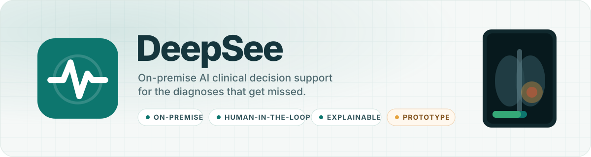
  </picture>
</p>

<p align="center">
  <a href="https://github.com/sysen5151-fall2026/DeepSee/actions/workflows/ci.yml"></a>
  
  
  
  
  
  <a href="LICENSE"></a>
</p>

<p align="center">
  <a href="#quick-start-demo-mode-no-backend">Quick start</a> ·
  <a href="#the-clinician-workflow">Workflow</a> ·
  <a href="#architecture">Architecture</a> ·
  <a href="#model">Model</a> ·
  <a href="#verification">Verification</a> ·
  <a href="#roadmap">Roadmap</a>
</p>

## Operational Concept

Source: the team's Innoslate model (DeepSee project), [Asset Diagram for the Universe context](https://cloud.innoslate.com/cornell/p/758/diagrams/asset/199263),
retrieved 18 Nov 2026. The model defines the operational concept through this diagram and the
descriptions of its elements and interfaces. Those descriptions are copied below without
rewording. The model holds no separate narrative paragraph.

> **X.C.1 DeepSee Operational Environment.** The operational environment (context) in which
> DeepSee is used: the people, data sources, network and workstation resources that interact
> with DeepSee but are outside its boundary.

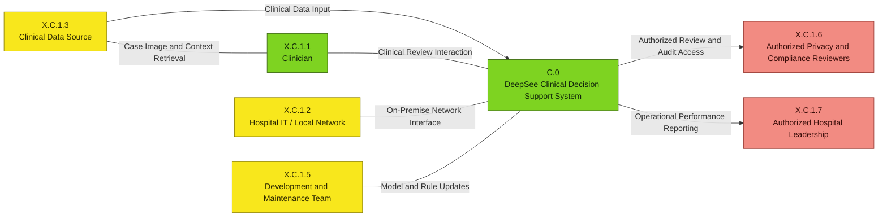

Green is working, yellow is partial, red is not yet built. The same colors are set on the
diagram in Innoslate.

### OpsCon to as built

Status on 18 Nov 2026. Interface descriptions in the second column are the model's own text.

| OpsCon element | Interface in the model | Where it lives in this repository | Status |
| --- | --- | --- | --- |
| C.0 DeepSee Clinical Decision Support System | The system itself | `frontend/` (clinician workspace), `backend/core/` (local analysis service, Chest X-ray CNN, knowledge layer) | **Working.** The primary use case UC.1 is implemented end to end. P.4 to P.6 are partial: the overlay is drawn in the browser, the decision has no authorization check, and review records stay in the browser. |
| X.C.1.1 Clinician | **Clinical Review Interaction.** "In: credentials, case selection, confirmed inputs, review decision and note. Out: case summary, pneumonia finding (suspected or not suspected) with model score and evidence, context indicators labelled as not image findings, analysis unavailable notice, save confirmation, exported case PDF." | `frontend/app/`, `frontend/components/ui/`, `backend/core/auth_service/` | **Working** |
| X.C.1.3 Clinical Data Source | **Clinical Data Input.** "One frontal chest radiograph (PNG or JPEG) and the available patient context, supplied for the selected case. Nothing is written back." **Case Image and Context Retrieval.** "The clinician obtains the frontal chest radiograph and available patient context from the clinical data source before supplying them to DeepSee." | `frontend/components/ui/ImageUploader.tsx`, samples in `frontend/assets/x-ray-images/` | **Partial.** The clinician selects an image file on the workstation and types the patient context. No PACS or EHR connection. |
| X.C.1.2 Hospital IT / Local Network | **On-Premise Network Interface.** "Represents the hospital-managed local network infrastructure supporting the DeepSee deployment. Clinical data exchanges are modeled separately through the clinical data and clinician interaction conduits. Case data remains within the hospital network." | `docs/adr/0001-initial-toolchain.md`, `frontend/.env.example`, `backend/.env.example` | **Partial.** Frontend and backend run on one local machine and no public AI endpoint is called. No hospital network deployment and no egress test. |
| X.C.1.5 Development and Maintenance Team | **Model and Rule Updates.** "Versioned model files, knowledge rules and software releases delivered to the local deployment; verification evidence returned." | `.github/workflows/`, `tests/`, `backend/core/imaging_service/model/`, `backend/core/imaging_service/knowledge_base.py` | **Partial.** CI and 25 requirement tests run on every push; the model is versioned as `cnn-pneumonia-v1`. No update, rollback or revalidation procedure. |
| X.C.1.6 Authorized Privacy and Compliance Reviewers | **Authorized Review and Audit Access.** "Provides O.3 Review / Audit Records from C.0 DeepSee to authorized privacy and compliance personnel under applicable access and data protection policies." | None. Saved reviews stay in the clinician's browser (`frontend/utils/caseHistory.ts`). | **Not yet built** |
| X.C.1.7 Authorized Hospital Leadership | **Operational Performance Reporting.** "Provides O.4 Performance Reports from C.0 DeepSee to authorized hospital leadership for operational review." | None | **Not yet built** |

Requirement level status is in [SPEC.md](SPEC.md). Function to module to test traceability is in
[docs/traceability.md](docs/traceability.md).

## Prototype overview

DeepSee puts a ranked, explainable differential beside the clinician at the moment of review. It runs inside the care setting's own network, keeps protected health information local, and leaves every decision with a person.

This repository holds the SYSEN 5151 (Fall 2026) course prototype: a clinician workspace built with Next.js and a local inference service built with Django and TensorFlow. It builds on an open-source [chest X-ray CDSS project](docs/ORIGINAL_CDSS_README.md), credited under [License](#license), and adds the DeepSee clinical hierarchy, privacy signalling, decision capture, and local case history.

> **Disclaimer.** DeepSee is an educational prototype. It is not a medical device and has not been clinically validated. All outputs must be reviewed by qualified healthcare professionals alongside clinical findings and other diagnostic tests.

## Quick start (demo mode, no backend)

```bash
git clone https://github.com/sysen5151-fall2026/DeepSee.git
cd DeepSee/frontend
npm install
npm run dev
```

Open http://localhost:3000, sign in with any username and password, and run a review. Demo mode runs a mock model in the browser and makes no network calls. Sample chest X-rays are in `frontend/assets/x-ray-images/`.

To run against the real CNN, see [Connected mode](#connected-mode-local-inference-service).

## The clinician workflow

Every screen below is captured from the demo-mode prototype by the end-to-end smoke test (`frontend/e2e/smoke.js`).

<table>
  <tr>
    <td width="42%" valign="top">
      <h3>1 · Sign in to a local workspace</h3>
      <p>Authentication happens against the on-premise service, never a public identity provider. The header always states the current mode: <b>Demo mode · mock model</b> or <b>Local processing</b>.</p>
    </td>
    <td width="58%">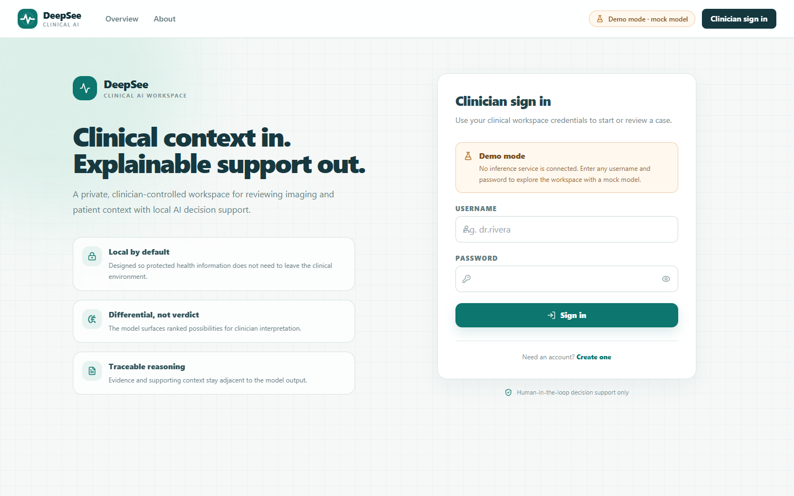</td>
  </tr>
  <tr>
    <td valign="top">
      <h3>2 · Bring the case together</h3>
      <p>A three-step rail guides the review: frontal chest X-ray, then patient context (birthdate, sex, temperature, blood pressure, heart rate, cough, headache, smell/taste), then a confirmation view before inference. The image stays on the workstation.</p>
    </td>
    <td>
      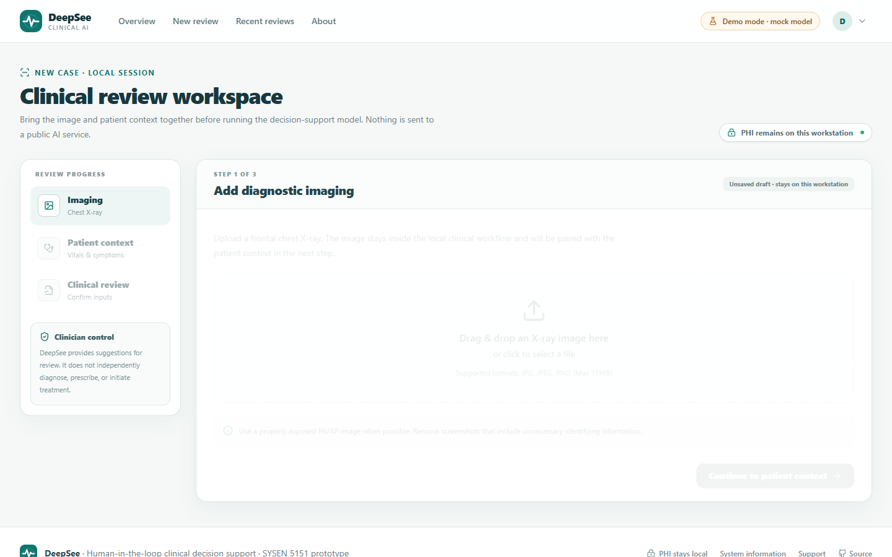
      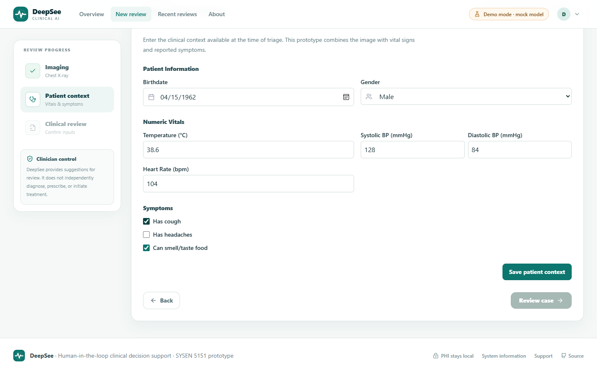
    </td>
  </tr>
  <tr>
    <td valign="top">
      <h3>3 · Review before analysis</h3>
      <p>Inputs are summarised side by side with the image so the clinician confirms what the model will see. Nothing runs until <b>Run clinical analysis</b> is pressed.</p>
    </td>
    <td>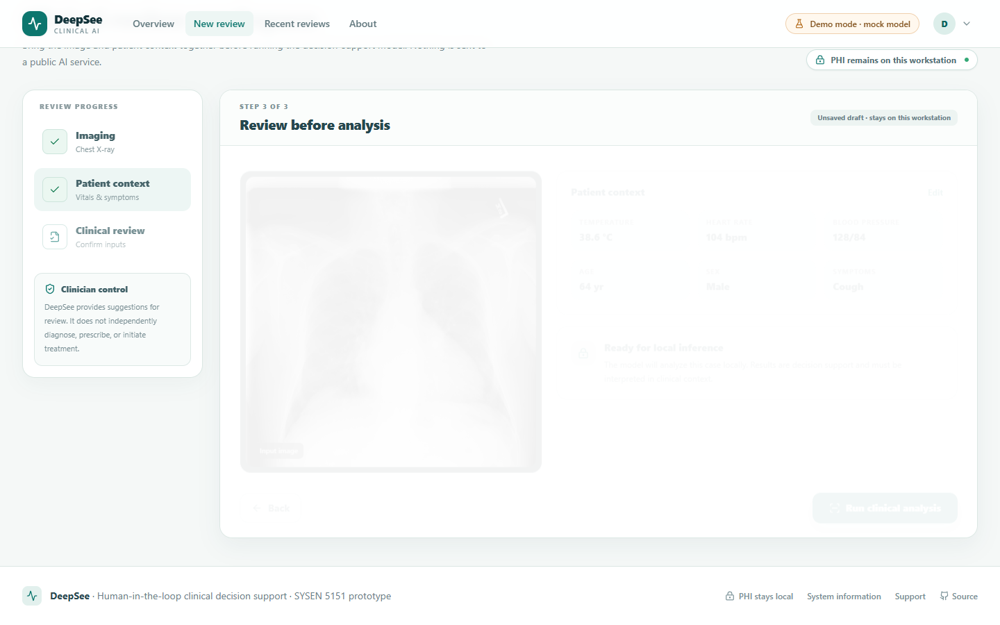</td>
  </tr>
</table>

### 4 · Case interpretation

The result screen follows clinical hierarchy: a plain-language summary, the ranked differential with model confidence, an attention overlay on the image, an evidence trail that separates model output from clinical input and rule-based refinement, next-step prompts, and a **clinician decision** panel. The citation layer is labelled *not connected* rather than fabricated.

<p align="center">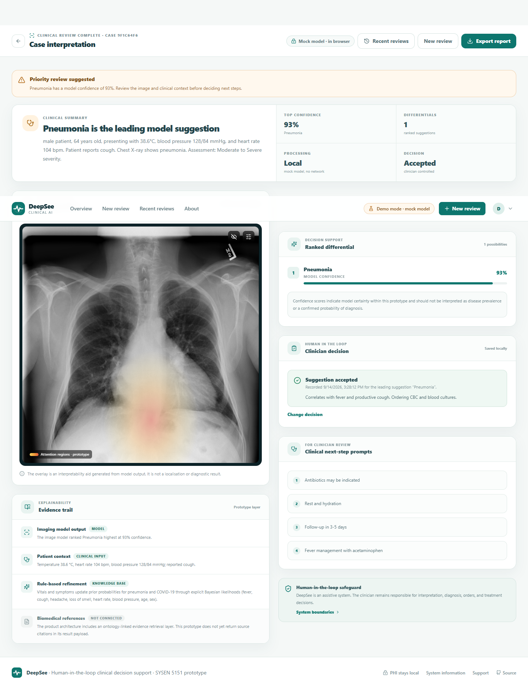</p>

<table>
  <tr>
    <td width="42%" valign="top">
      <h3>5 · Record the decision, export, reopen</h3>
      <p>Accept, reject, or mark the leading suggestion indeterminate, add a note, and export a PDF that carries the decision and the decision-support disclaimer. Reviews are kept in the browser on the clinician's workstation under <b>Recent reviews</b> and can be reopened with their decision intact.</p>
    </td>
    <td width="58%">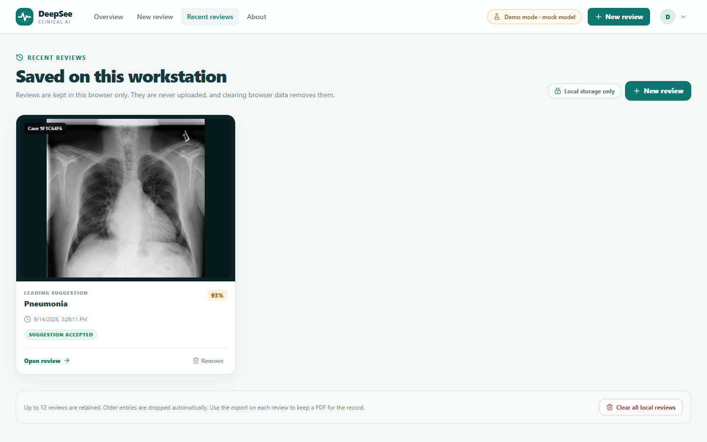</td>
  </tr>
  <tr>
    <td valign="top">
      <h3>Transparency pages</h3>
      <p><b>System information</b> states what DeepSee does and does not do, the architecture, a model card, and a status table for every capability. <b>Support</b> offers session diagnostics with no patient data and a one-click way to clear local reviews on a shared workstation.</p>
    </td>
    <td>
      <a href="docs/screenshots/about.png">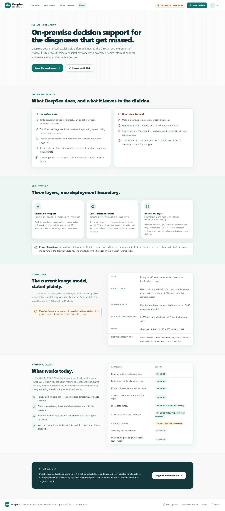</a>
      <a href="docs/screenshots/support.png">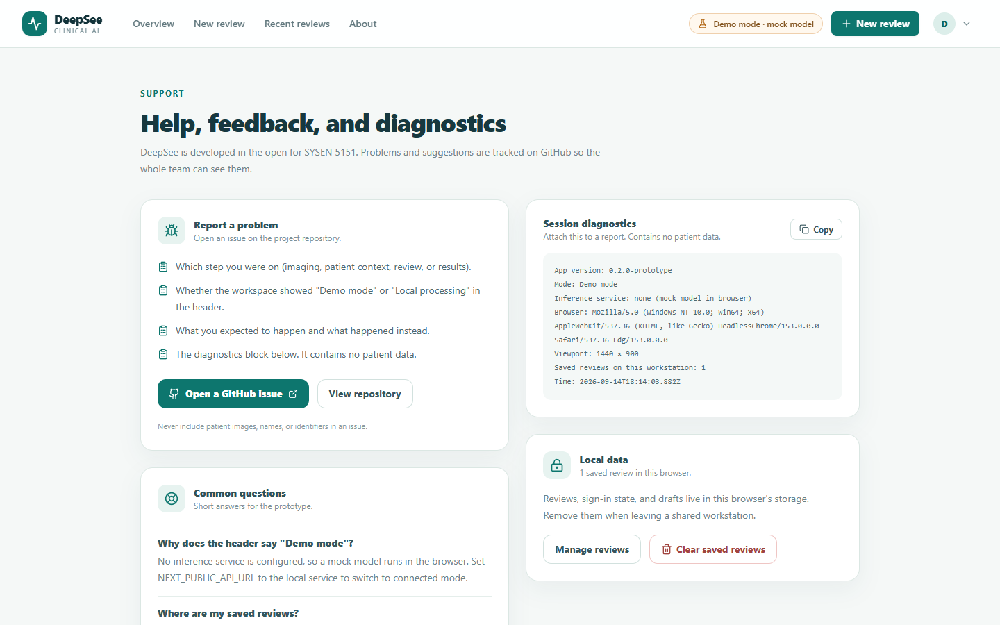</a>
    </td>
  </tr>
</table>

## Connected mode (local inference service)

Requires Python 3.10 to 3.12.

```bash
cd backend
python -m venv .venv && source .venv/bin/activate   # Windows: .venv\Scripts\activate
pip install -r core/requirements.txt
cd core && python manage.py migrate && python manage.py runserver
```

Then, in `frontend/.env.local`:

```
NEXT_PUBLIC_API_URL=http://localhost:8000
```

Register a clinician account from the workspace and start a review. Details: [backend/README.md](backend/README.md).

## Architecture

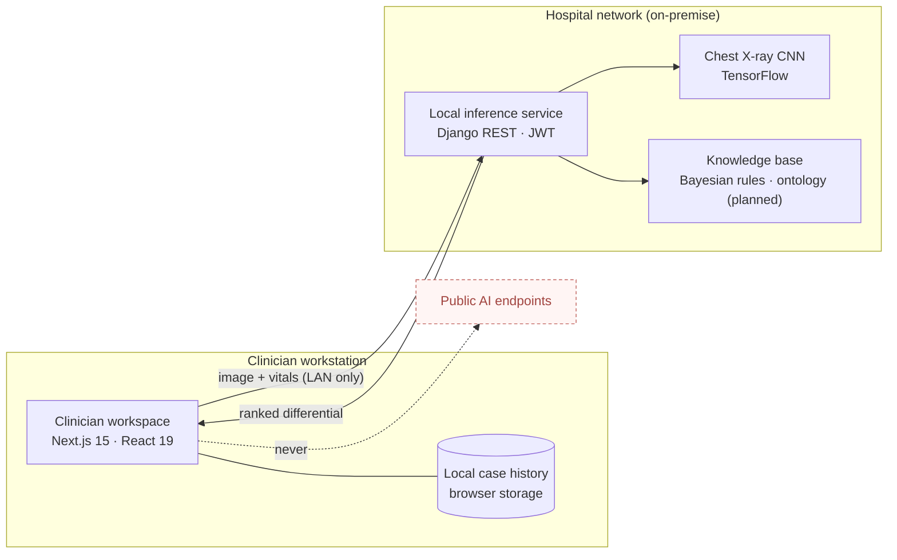

| Layer | Stack | Responsibility |
| --- | --- | --- |
| Clinician workspace | Next.js 15, React 19, TypeScript, Tailwind | Guided review flow, evidence trail, decision capture, PDF export, local history |
| Local inference service | Django 5.2, DRF, SimpleJWT, TensorFlow 2.19 | Authentication, CNN inference, knowledge-base refinement, ranked differential |
| Knowledge layer | Bayesian priors and likelihoods | Updates pneumonia and COVID-19 probabilities from vitals, symptoms, age, sex |

## Repository layout

```
README.md              Operational concept from the model, as built status, prototype overview
SPEC.md                Stakeholder requirements SR1 to SR18 with status, data and response contracts

frontend/              Next.js clinician workspace (see frontend/README.md)
backend/               Django analysis service and CNN model (see backend/README.md)
  core/imaging_service/clinical_analysis/   F.3 Perform Clinical Analysis, one module per function F.3.1 to F.3.4
tests/                 Requirement tests, named by requirement ID (pytest)
contracts/api-v1.yaml  Interface contract (OpenAPI) for F.3 and its internal flows

clinician_interface/   Boundary anchor: Clinician
imaging_source/        Boundary anchor: chest X-ray image source
workstation_store/     Boundary anchor: clinician workstation store (retired in the model)
knowledge_source/      Boundary anchor: biomedical knowledge source (not connected)

docs/
    traceability.md    Function to module to requirement to test
    requirements-f3.md Requirement flow down for F.3
    route-table.md     Product entry points mapped to use case steps
    context.md         External-system boundary inventory (September context, see divergence)
    ch10/              Modeling and simulation data: Innoslate results, replica script, measured timings
    environment.md     Toolchain record
    prompt-log.md      AI-assisted work provenance
    adr/0001-initial-toolchain.md
    brand/, screenshots/, UI_DESIGN_NOTES.md, original project report, dataset README
.github/workflows/     ci.yml (frontend typecheck and build, backend syntax check), tests.yml (requirement tests)
```

The four boundary directories are named for elements in the Innoslate model
rather than for the technology behind them, per Lab Manual §1.4.2. They contain
documentation only; each one points at the code that implements that boundary
today. See the mapping table at the end of [docs/context.md](docs/context.md).

## Model

The current image model is the five-block CNN from the original project, trained on the Kaggle chest X-ray pneumonia dataset (about 5,000 images) with a reported accuracy of 89.9%. It is a binary pneumonia classifier with no localisation output. A multi-finding model on NIH ChestX-ray14 labels is the planned replacement; the dataset README is in `docs/`.

Model confidence is a property of the classifier, not the probability that a patient has the disease. The interface says so wherever a number appears.

## Verification

| Check | Command | Status |
| --- | --- | --- |
| Type check | `cd frontend && npm run typecheck` | Passes |
| Production build | `cd frontend && npm run build` | Passes, 12 routes |
| End-to-end smoke test (demo flow) | `cd frontend && npm run start` then `npm run e2e` | 21 checks pass |
| Backend syntax | `python -m compileall backend/core` | Passes |
| Requirement tests (F.3) | `python -m pytest tests -v` | 25 tests pass |

The smoke test drives a real browser (installed Edge by default; see `frontend/e2e/smoke.js`) through sign-in, upload, patient context, analysis, decision capture, local history, reopening a case, and sign-out. CI runs the type check, build, backend syntax check, and requirement tests on every push.

## Model and product divergence

The Innoslate model is the specification and the product follows it. Where the
two currently differ, the difference is recorded here rather than resolved by
quietly editing one to match the other.

The runnable prototype implements a **narrower** diagnostic path than the DeepSee
architecture describes. What runs today is chest X-ray analysis by a binary
pneumonia classifier, refined by an in-product Bayesian table over vitals and
symptoms. The broader architecture (ontology-linked evidence retrieval with
source citations, and multi-finding classification) is named on the context
diagram as planned and is listed under [Roadmap](#roadmap). It is not
implemented, and the interface labels it *not connected* rather than fabricating
citations.

A second, deliberate divergence: §1.4.2 asks for one top-level directory per
boundary element. The boundary directories exist and carry that naming, but the
working code stays in `frontend/` and `backend/`, which are named for technology.
Moving it would break CI, every documented command and every import, for no
traceability that the mapping table in [docs/context.md](docs/context.md) does
not already provide. Recorded as assumption 4 in
[docs/prompt-log.md](docs/prompt-log.md).

A third divergence, found on 18 Nov 2026: the context in the model was revised after this
repository's boundary documents were written. The model retired the clinician workstation store
as an external element (saved reviews are now inside the system) and added three elements: the
development and maintenance team, privacy and compliance reviewers, and hospital leadership.
[docs/context.md](docs/context.md) and the four boundary directories still describe the
September context. The table under [Operational Concept](#operational-concept) follows the
current model; the older documents are due for update in the integration work.

## Roadmap

- Ontology-linked evidence retrieval with source citations in the result payload
- Multi-finding classifier (NIH ChestX-ray14) with Grad-CAM attention maps from the model itself
- Server-side case records with audit trail, replacing browser-only history
- DICOM ingestion and PACS integration
- Audit records and reviewer access for privacy and compliance staff (SR18)
- Operational performance report for hospital leadership (SR10)
- Clinical validation study design

## Brand

<p>
  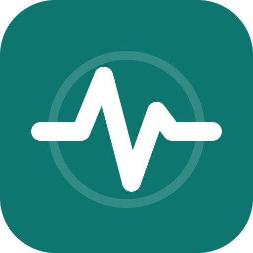
  The mark is a vital-sign trace inside a lens on deep teal: <em>seeing the signal</em>. Assets live in <code>docs/brand/</code>: <code>deepsee-mark.svg</code> and <code>deepsee-mark.png</code> (icon), <code>deepsee-logo.svg</code> and <code>deepsee-logo-dark.svg</code> (horizontal lockup), <code>deepsee-banner.svg</code> and <code>deepsee-banner-dark.svg</code> (README header). Colours: teal <code>#0d766e</code>, ink <code>#15363d</code>, surface <code>#f5f8f7</code>, priority amber <code>#e6a33d</code>.
</p>
<br clear="left">

## Design principles

See [docs/UI_DESIGN_NOTES.md](docs/UI_DESIGN_NOTES.md). In short: clinical hierarchy over marketing UI, human-in-the-loop made explicit, privacy made visible, calm medical visual system, and explainability without fabrication.

## License

MIT. See [LICENSE](LICENSE). The original CDSS chest X-ray project is by Mahmoud Mansy and team (Cairo University, Faculty of Engineering).
